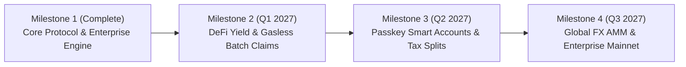

# ⚡ StellarFlow Protocol Proposal

### Transforming Corporate Payroll & Digital Value Transfer on the Stellar Blockchain

- **Author & Lead Maintainer:** `escaprt` (<escaprtyu@gmail.com>)
- **Repository:** [https://github.com/escaprt/stellarflow](https://github.com/escaprt/stellarflow)
- **Target Network:** Stellar (Mainnet & Testnet)
- **Contract Deployment (Testnet):** [`CCJW2RLIN4MQQ4DAJMMR3F5QPDA6QYTKXJMEVI3XOTDBTBCLBB553J74`](https://stellar.expert/explorer/testnet/contract/CCJW2RLIN4MQQ4DAJMMR3F5QPDA6QYTKXJMEVI3XOTDBTBCLBB553J74)
- **Status:** Production-Ready MVP & Protocol Evolution Proposal
- **Date:** November 2026

---

## 1. Executive Summary

Traditional financial infrastructure forces the global workforce into an antiquated, friction-heavy compensation model: working for 15 to 30 days before receiving wages. This disconnect causes severe cashflow volatility, forces vulnerable workers into predatory payday credit, and generates operational reconciliation overhead for businesses.

Simultaneously, existing Web3 streaming solutions on Ethereum and EVM Layer-2s are compromised by unpredictable gas spikes ($2 to $40 per claim), latency bottlenecks, and complex bridge infrastructure, while lacking the enterprise tools necessary for real-world business adoption (such as mass CSV payroll ingestion, live stream adjustments, and legally compliant tax remittance slips).

**StellarFlow** is an open-source, non-custodial programmable payment streaming protocol purpose-built for the **Stellar Network** and powered by **Soroban Smart Contracts**. StellarFlow transforms fixed periodic disbursements into **sub-second continuous liquidity**, enabling companies, DAOs, and contractors to stream stablecoins (USDC, EURC) and native assets (XLM) continuously over time with deterministic 3–5 second finality and sub-cent transaction costs.

---

## 2. The Problem Statement

### 2.1 The Bi-Weekly / Monthly Payroll Trap & Cashflow Asymmetry
In the traditional economy, compensation is bundled into bi-weekly or monthly batches. Workers extend 30 days of interest-free labor to their employers while bills, rents, and emergency expenses occur daily. In the United States alone, over **$30 billion** is spent annually on payday loan interest and overdraft fees to bridge this artificial cashflow gap. For global remote workers and gig contractors, cross-border banking rails exacerbate this with 3–7 day clearing delays and 3–8% FX fees.

### 2.2 Counterparty & Default Risk in Contractor Engagements
In freelancing and milestone consulting:
- **Contractors** fear non-payment or arbitrary dispute after investing weeks of labor.
- **Clients** fear paying large upfront retainers only to receive sub-par work or suffer ghosting.
- **Traditional Escrow** is slow, adversarial, and binary (all-or-nothing disputes).

Continuous second-by-second streaming eliminates this tension: value is vested continuously as work is delivered. If expectations diverge, the stream can be paused or canceled instantly, ensuring neither party is exposed to more than a single day or hour of uncompensated risk.

### 2.3 The Blockchain Inefficiency Barrier on EVM Protocols
Payment streaming requires frequent state interactions: stream creation, top-ups, cliff evaluation, and periodic claims. On Ethereum, Polygon, or Arbitrum:
- Gas costs fluctuate wildly based on network congestion. A worker claiming a $50 daily stream might pay $15 in gas fees, destroying the economic viability of micro-streaming.
- Transaction reorgs and unpredictable latency prevent responsive user experiences.

**Stellar is uniquely positioned to solve this:**
- Deterministic 3–5 second ledger closes.
- Predictable, negligible transaction fees (~0.00001 XLM / fractions of a cent).
- Native enterprise token standard (SEP-41) and pre-integrated fiat off-ramp anchor rails (SEP-24 / SEP-38) across 150+ countries.

### 2.4 Enterprise & Compliance Deficits in Existing Web3 Streaming
Existing Web3 streaming tools (such as Sablier or Superfluid) were designed primarily for token vesting in decentralized protocols. They lack essential enterprise primitives:
1. No native multi-employee CSV bulk import engine.
2. Inability to inject capital (top-up) or extend duration without terminating and redeploying streams.
3. No audit-compliant, printable remittance slips or tax withholding records.

---

## 3. The StellarFlow Architecture & Core Protocol

StellarFlow combines a mathematically rigorous Soroban smart contract, an enterprise-grade Express/SQLite event indexer, and an ultra-optimized reactive React interface.

```
┌────────────────────────────────────────────────────────────────────────────────────────┐
│                               STELLARFLOW PROTOCOL ARCHITECTURE                        │
├────────────────────────────────────────────────────────────────────────────────────────┤
│                                                                                        │
│   +──────────────────────────+                  +──────────────────────────────────+   │
│   │   Employer / Corporate   │                  │       Contractor / Employee      │   │
│   │   HR (Sender Console)    │                  │       (Recipient Portal)         │   │
│   +────────────┬─────────────+                  +─────────────────▲────────────────+   │
│                │                                                  │                    │
│                │ 1. Bulk CSV / Batch Streams                      │ 4. Instant Claim   │
│                ▼                                                  │    & Printable PDF │
│   +───────────────────────────────────────────────────────────────┴────────────────+   │
│   │                       StellarFlow Reactive Frontend UI                         │   │
│   │      (Sub-Second Ticking Counters, Glassmorphism, PWA, Route Chunk Splitting)  │   │
│   +────────────┬──────────────────────────────────────────────────▲────────────────+   │
│                │                                                  │                    │
│                │ 2. Signed Soroban Invocation                     │ 5. Polling / Live  │
│                ▼                                                  │    Stream State    │
│   +───────────────────────────────────────────────────────────────┴────────────────+   │
│   │                     Soroban Smart Contract Escrow                              │   │
│   │                     (Testnet: CCJW2RLIN4MQQ4DAJMMR3F5QPDA6QYTKXJMEVI3XOTDBT...) │   │
│   │   - Mathematical Linear Vesting Formula                                        │   │
│   │   - Cliff Enforcement & Solvency Invariant                                     │   │
│   │   - Dynamic Top-Up & Extension State Updates                                   │   │
│   +────────────┬───────────────────────────────────────────────────────────────────+   │
│                │                                                                       │
│                │ 3. On-Chain Ledger Events                                             │
│                ▼                                                                       │
│   +────────────────────────────────────────────────────────────────────────────────+   │
│   │                       Backend Indexing & Webhook Engine                        │   │
│   │   - Soroban RPC Circuit Breaker with Exponential Backoff                       │   │
│   │   - SQLite Write-Ahead Logging (WAL) Persistent Store                          │   │
│   │   - HMAC-SHA256 Idempotent Webhook Worker & Dead Letter Queue                  │   │
│   +────────────────────────────────────────────────────────────────────────────────+   │
│                                                                                        │
└────────────────────────────────────────────────────────────────────────────────────────┘
```

### 3.1 Mathematical Vesting Formula
For any stream $S$ defined by start timestamp $t_{\text{start}}$, end timestamp $t_{\text{end}}$, total amount $A$, cliff timestamp $t_{\text{cliff}}$, and already claimed amount $C$:

$$\text{vested}(t) = \begin{cases} 
0 & \text{if } t < t_{\text{cliff}} \\
A & \text{if } t \ge t_{\text{end}} \\
A \times \frac{t - t_{\text{start}}}{t_{\text{end}} - t_{\text{start}}} & \text{if } t_{\text{cliff}} \le t < t_{\text{end}}
\end{cases}$$

The currently claimable amount at any timestamp $t$ is:
$$\text{claimable}(t) = \max(0, \text{vested}(t) - C)$$

Upon cancellation by the sender at timestamp $t_{\text{cancel}}$:
- **Recipient Receives / Can Claim:** $\text{vested}(t_{\text{cancel}}) - C$
- **Sender Refunded:** $A - \text{vested}(t_{\text{cancel}})$

### 3.2 Escrow Solvency Invariant
The smart contract guarantees the fundamental escrow invariant:
$$\text{contract\_balance} \ge \sum_{i \in \text{ActiveStreams}} \left( A_i - C_i \right)$$
No stream can be overdrawn, and individual stream liabilities are strictly isolated.

---

## 4. Production Capabilities Implemented (Phase 1)

The following enterprise capabilities have been designed, implemented, and verified across 360+ automated test suites:

### 1. Enterprise Bulk Payroll Engine
- **Endpoint:** `POST /api/streams/batch`
- **Features:**
  - Multi-recipient atomic stream initiation.
  - Interactive table UI supporting custom recipient public keys, individual compensation amounts, and rate distribution.
  - Full CSV importer allowing corporate payroll managers to paste raw CSV rows from standard HR tools (Workday, Deel, Gusto).
  - 1-Click "Load Demo Team" button for immediate sandbox evaluation.

### 2. Dynamic Stream Top-Up & Duration Extension
- **Endpoints:** `POST /api/streams/:id/topup`, `POST /api/streams/:id/extend`
- **Features:**
  - Employers can inject additional capital into active streams without interrupting continuous vesting.
  - Employers can extend the contract end date with real-time automated recalculation of the per-second flow rate.
  - Front-end integration via interactive action modals inside the `StreamDetailDrawer`.

### 3. Official Payment Receipt & Remittance Slip
- **Endpoint:** `GET /api/streams/:id/receipt`
- **Features:**
  - Emits formal payment receipts with cryptographic Soroban transaction hashes, flow rates, sender/recipient addresses, and timestamps.
  - Built-in `@media print` styling transforming the modal into a clean, printable PDF remittance invoice suitable for corporate tax reporting.
  - 1-Click plain-text clipboard export and direct links to the Stellar Expert blockchain explorer.

### 4. Production Bundle Optimization & PWA
- **Architecture:** Split vendor chunks for `@stellar/stellar-sdk`, `recharts`, and `react-core`.
- **Results:** Reduced `RecipientDashboard` vendor chunk footprint from **557 kB to 16.3 kB**, achieving sub-second initial load times even on slow 3G mobile connections.

---

## 5. Proposed Next-Gen Modifications (Phase 2 & Phase 3)

To evolve StellarFlow from an enterprise streaming tool into the undisputed liquidity and payroll backbone of the Stellar ecosystem, we propose the following five major architectural modifications:

### 💡 Modification 1: DeFi Yield-Bearing Streaming Escrows (Blend Protocol)
- **The Problem:** In a 1-year vesting schedule of $1,000,000 USDC, an average of $500,000 sits completely idle in smart contract escrow throughout the year, generating zero economic return.
- **The Modification:**
  - Integrate StellarFlow's Soroban contract with Stellar money markets (such as Blend or SEP-41 yield-bearing pools).
  - Idle principal in the stream escrow is automatically converted into yield-bearing interest tokens (e.g. `bUSDC`).
  - **Configurable Yield Policy:**
    - *Option A (Worker Incentive):* Yield is streamed alongside principal as an inflation hedge for employees.
    - *Option B (Corporate Rebate):* Accrued yield is credited back to the corporate treasury, reducing employer payroll expenses by 4–8% APR.

### 💡 Modification 2: Gasless Multi-Stream Batch Claims via Fee Bumps (CAP-15)
- **The Problem:** A contractor working for multiple clients or receiving split tokens (USDC + XLM) must submit separate on-chain transactions for each stream, incurring friction and requiring an initial native XLM balance for transaction fees.
- **The Modification:**
  - Implement a batch claim function in the smart contract: `claim_multiple(stream_ids: Vec<u64>)`.
  - Wrap claims in Stellar **Fee Bump Transactions** (CAP-15), allowing employers or the StellarFlow protocol relayer to sponsor network fees.
  - Enables zero-balance recipients to claim their funds with 0 XLM in their wallet.

### 💡 Modification 3: Decentralized Multi-Wallet & Passkey Smart Accounts
- **The Problem:** Non-crypto corporate employees find browser wallet extension installations and 24-word seed phrase management daunting, leading to onboarding drop-offs.
- **The Modification:**
  - Integrate **Stellar Wallets Kit**, providing immediate support for Freighter, Albedo, xBull, Hana, Rabet, and Ledger.
  - Implement **WebAuthn Passkey Smart Accounts** using Soroban account abstraction: employees log in and authorize claims using biometric TouchID / FaceID or Windows Hello with zero seed phrase friction.

### 💡 Modification 4: Automated Split-Streaming & Tax Withholding Rails
- **The Problem:** Global contractors and corporate employees must manually calculate and set aside taxes each month, leading to compliance failures and IRS/HMRC reporting hurdles.
- **The Modification:**
  - Add native stream splitting directly into the Soroban contract:
    - 75% streams to the Employee's personal wallet.
    - 20% streams to a designated Tax Escrow Account.
    - 5% streams to a retirement / savings vault.
  - Automated generation of monthly tax summary CSVs compliant with standard W-2 and 1099 reporting.

### 💡 Modification 5: Real-Time Cross-Border FX Auto-Swapping (Soroban AMM)
- **The Problem:** Multinational corporations budget in USDC or EURC, but employees in emerging markets (e.g., Latin America, Southeast Asia, Africa) need local currencies for daily living expenses.
- **The Modification:**
  - Connect stream claims to Soroban DEX / AMM liquidity pools.
  - When an employee claims their stream, the contract can atomically swap USDC to local stablecoins (such as BRL, ARS, or EURC) at real-time market rates and route directly to local SEP-24 off-ramp anchors.

---

## 6. Economic & Performance Benchmark

| Metric / Dimension | StellarFlow (Stellar) | Sablier (Ethereum) | Superfluid (Arbitrum) | Streamflow (Solana) |
| :--- | :--- | :--- | :--- | :--- |
| **Transaction Finality** | **3 – 5 seconds (Deterministic)** | 12 – 15 minutes | 1 – 2 seconds | 400ms (Probabilistic) |
| **Stream Creation Fee** | **<$0.001 (0.0001 XLM)** | $15.00 – $60.00 | $0.25 – $1.50 | $0.005 |
| **Claim Fee** | **<$0.0001** | $5.00 – $25.00 | $0.15 – $0.80 | $0.002 |
| **Network Reorg Vulnerability** | **None (SCP Consensus)** | Low (PoS Finality) | Moderate (Sequencer) | Moderate (Forking risk) |
| **Integrated Fiat Anchors** | **150+ Countries (SEP-24)** | Third-party CEX only | Third-party CEX only | Limited fiat rails |
| **Bulk CSV Payroll Engine** | **Built-in (Native)** | None / Manual | Third-party plugin | Basic |
| **Printable Remittance Invoices** | **Built-in (Audit-Ready)**| None | None | None |

---

## 7. Delivery Roadmap & Milestones



### Milestone 1: Core Protocol & Enterprise Foundation (Completed)
- [x] Deployment of Soroban streaming contract to Stellar Testnet.
- [x] Enterprise Bulk Payroll Engine with multi-row table, CSV upload, and demo loader.
- [x] Dynamic stream top-up and duration extension with real-time rate recomputation.
- [x] Official payment receipt modal with `@media print` PDF generation.
- [x] Client bundle optimization reducing initial payload to 16.3 kB.
- [x] 100% test pass rate across 360+ frontend and backend test suites.

### Milestone 2: DeFi Yield & Gasless Batch Claims (Q1 2027)
- [ ] Integration of Blend protocol yield hooks for escrowed stream capital.
- [ ] Multi-stream batch claim smart contract function (`claim_multiple`).
- [ ] Stellar Fee Bump transaction relayer infrastructure (CAP-15 sponsorship).
- [ ] Employer yield rebate analytics dashboard.

### Milestone 3: Passkey Accounts & Compliance Automation (Q2 2027)
- [ ] WebAuthn Passkey integration for biometric wallet authentication.
- [ ] Stellar Wallets Kit support (Albedo, xBull, Hana, Rabet).
- [ ] Native stream splitting engine for automated tax withholding.
- [ ] Exportable W-2 / 1099 compliant tax reports.

### Milestone 4: Global FX & Enterprise Mainnet Launch (Q3 2027)
- [ ] Atomic AMM swap on stream claim for local currency delivery.
- [ ] Direct SEP-24 / SEP-38 anchor integration for instant bank deposit off-ramps.
- [ ] Formal third-party smart contract audit.
- [ ] Production deployment on Stellar Public Network (Mainnet).

---

## 8. Open-Source Commitment & Governance

StellarFlow is licensed under the permissive **MIT License** and is built strictly with open standards:
- **Soroban Smart Contract Standards:** Standard Rust and Soroban SDK interfaces.
- **Stellar Ecosystem Proposals:** Built to adhere to SEP-10 (Authentication), SEP-41 (Token Interface), and SEP-24 (Interactive Deposit & Withdrawal).
- **Public Governance:** All protocol improvements, security advisories, and architecture decision records (ADRs) are openly maintained at:
  [https://github.com/escaprt/stellarflow](https://github.com/escaprt/stellarflow)

---

## 9. Conclusion

StellarFlow unlocks continuous liquidity for the global digital economy. By combining the speed, micro-fees, and global anchor infrastructure of Stellar with the expressive power of Soroban smart contracts, StellarFlow transforms how organizations compensate talent, manage contractor risk, and transfer value.

We invite the Stellar Development Foundation (SDF), the Stellar Community Fund (SCF), enterprises, and open-source builders to join us in establishing StellarFlow as the premier continuous finance protocol.
