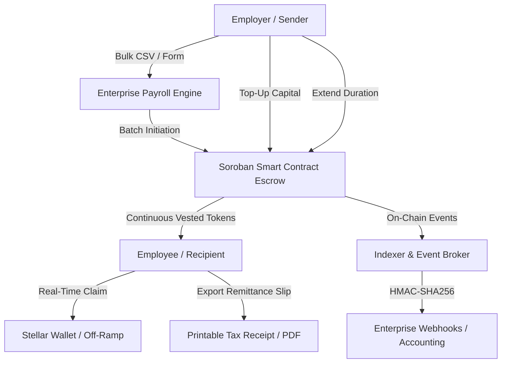

<div align="center">

# ⚡ StellarFlow

### Real-Time Payment & Continuous Payroll Streaming Protocol on Stellar

[](LICENSE)
[](https://stellar.org)
[](https://soroban.stellar.org)
[](https://github.com/escaprt/stellarflow)
[](frontend/)
[](backend/)

**StellarFlow** is an enterprise-grade programmable payment streaming protocol engineered for the **Stellar Network** and powered by **Soroban Smart Contracts**. It replaces obsolete 30-day bi-weekly payroll cycles, binary milestone escrows, and expensive cross-border wire transfers with **sub-second continuous liquidity**.

[Explore Protocol Proposal (PROPOSAL.md)](PROPOSAL.md) • [API Documentation](#-api-reference) • [Quickstart Guide](#-quickstart) • [Architecture](#-protocol-architecture)

---

</div>

## 🌐 Deployed Smart Contract (Stellar Testnet)

| Parameter | Network Detail |
| :--- | :--- |
| **Contract ID** | [`CCJW2RLIN4MQQ4DAJMMR3F5QPDA6QYTKXJMEVI3XOTDBTBCLBB553J74`](https://stellar.expert/explorer/testnet/contract/CCJW2RLIN4MQQ4DAJMMR3F5QPDA6QYTKXJMEVI3XOTDBTBCLBB553J74) |
| **Network Passphrase** | `Test SDF Network ; September 2015` |
| **Horizon Endpoint** | `https://horizon-testnet.stellar.org` |
| **Soroban RPC** | `https://soroban-testnet.stellar.org:443` |
| **Supported Assets** | `USDC`, `EURC`, `XLM` (SEP-41 Soroban Tokens) |

---

## 🎯 The Real-World Problems StellarFlow Solves

### 1. The Lumpy Cashflow & Payday Debt Trap
- **The Problem:** In traditional payroll, employees work up to 30 days before receiving compensation. This liquidity mismatch drives millions of global workers into high-interest payday loans, credit debt, and financial stress, while businesses hold earned wages without real-time reconciliation.
- **The StellarFlow Solution:** Compensation streams continuously every second. Workers can monitor their earnings tick upwards in real time and withdraw their earned wages whenever needed, eliminating liquidity anxiety and predatory lending.

### 2. High Counterparty & Default Risk in Contracting
- **The Problem:** In freelance work and milestone consulting, contractors worry about non-payment upon project delivery, while clients worry about paying upfront deposits without guaranteed completion.
- **The StellarFlow Solution:** Continuous second-by-second micro-escrow. If work stops or deliverables fail, the employer pauses or cancels the stream; the worker retains every token vested up to that exact second, and unvested funds immediately return to the employer.

### 3. Prohibitive Fees & Latency on Other Blockchains
- **The Problem:** Streaming protocols on Ethereum and EVM Layer-2s suffer from volatile gas spikes ($5–$40 per claim or cancellation), delayed confirmations, and complex bridge infrastructure.
- **The StellarFlow Solution:** Stellar provides **3–5 second finality** and **fractions of a cent ($0.00001) per transaction**. Micro-payments and frequent claims become economically feasible for everyday payroll.

### 4. Enterprise Compliance & Usability Void in Web3
- **The Problem:** Most Web3 streaming tools are built for single 1-to-1 transfers. They lack corporate payroll tooling, bulk CSV upload capabilities, dynamic stream adjustments, and official remittance documentation.
- **The StellarFlow Solution:** StellarFlow delivers a full corporate suite: multi-row payroll tables, batch CSV importers, dynamic top-ups and duration extensions, and PDF-printable remittance slips with cryptographic Soroban verification.

---

## 🚀 Key Features & Capabilities



### 1. Enterprise Bulk Payroll Engine
- **Atomic Multi-Stream Initiation:** Create simultaneous payment streams for entire departments in a single batch operation (`POST /api/streams/batch`).
- **Interactive Multi-Row Table:** Manage employee addresses, individual compensation amounts, and rate distribution seamlessly.
- **CSV & Paste Importer:** Import hundreds of payroll lines from corporate HR systems (Workday, Gusto, Deel, QuickBooks) with automatic validation.
- **1-Click Demo Team:** Pre-populate realistic test payroll batches for instant sandbox demonstration.

### 2. Dynamic Stream Top-Up & Duration Extension
- **Non-Disruptive Top-Ups:** Inject additional capital into active streams without canceling or recreating them (`POST /api/streams/:id/topup`).
- **Flexible Extensions:** Extend stream durations on the fly with automatic flow-rate recomputation (`POST /api/streams/:id/extend`).
- **Modal Controls:** Sender dashboards include dedicated dialogs for instant budget adjustments.

### 3. Official Payment Receipts & Remittance Slips
- **Audit-Grade Invoices:** Instant cryptographic verification of payment streams with full transaction details (`GET /api/streams/:id/receipt`).
- **Print & PDF Optimization:** Custom `@media print` formatting generates professional remittance slips ready for corporate accounting and tax authorities.
- **1-Click Copy & Explorer Verification:** Copy plain-text remittance slips with direct links to [Stellar Expert](https://stellar.expert).

### 4. Production Performance & PWA Architecture
- **Vite Chunk Splitting:** Heavy vendor packages (`@stellar/stellar-sdk`, `recharts`, `react-core`) are isolated into independent chunks, reducing critical dashboard weight from **557 kB to 16.3 kB**.
- **Progressive Web App:** Offline-first caching, app manifest, and mobile responsiveness for desktop and mobile devices.

### 5. Resilient Indexing & Webhook Worker
- **Soroban RPC Circuit Breaker:** Exponential backoff, jitter, and automatic recovery against RPC timeouts.
- **Idempotent Webhooks:** Outbound events are signed with HMAC-SHA256 signatures, `Idempotency-Key` headers, and dead-letter retry queues.

---

## 🔮 Proposed Future Modifications & Roadmap

For full implementation specifications, see [PROPOSAL.md](PROPOSAL.md).

```
┌────────────────────────────────────────────────────────────────────────┐
│                        STELLARFLOW ROADMAP                             │
├────────────────────────────────┬───────────────────────────────────────┤
│ Phase 1: Core Protocol (Live)  │ • Soroban Escrow Contract             │
│                                │ • Enterprise Bulk Payroll Engine      │
│                                │ • Dynamic Top-Up & Extension Modals   │
│                                │ • Official Remittance Slips & PWA     │
├────────────────────────────────┼───────────────────────────────────────┤
│ Phase 2: DeFi & Scaling        │ • Yield-Bearing Escrows (Blend Yield) │
│                                │ • Gasless Multi-Stream Batch Claims   │
│                                │ • Fee Bump (CAP-15) Sponsorship       │
├────────────────────────────────┼───────────────────────────────────────┤
│ Phase 3: Identity & Compliance │ • Passkey WebAuthn (Stellar Wallets)  │
│                                │ • Automated Tax Withholding Splits    │
│                                │ • Real-Time FX AMM Auto-Swaps         │
└────────────────────────────────┴───────────────────────────────────────┘
```

1. **DeFi Yield-Bearing Streaming Escrows:** Route idle escrowed funds into Stellar lending protocols (such as Blend or liquidity pools), streaming both principal and accrued interest to recipients or rebating yield to employers.
2. **Gasless Multi-Stream Batch Claims (CAP-15):** Enable recipients with multiple income streams to claim all vested funds in a single transaction sponsored by the employer via Stellar Fee Bumps.
3. **Passkey Smart Accounts & Stellar Wallets Kit:** Frictionless WebAuthn login (TouchID / FaceID) removing seed-phrase barriers for non-crypto corporate employees.
4. **Automated Tax Withholding & Split Streams:** Built-in conditional stream splitting: automatically direct a designated percentage to tax reserves or local currency off-ramps with exportable W-2/1099 CSVs.
5. **Real-Time Cross-Border FX Auto-Swapping:** Employers stream USDC; global contractors receive local currency (e.g., EURC, BRL) swapped in real time via Soroban AMM pools.

---

## 🛠️ Tech Stack

- **Smart Contracts:** Rust, Soroban SDK v21.0, Stellar Testnet
- **Frontend:** React 18, TypeScript, Vite, Tailwind CSS, Lucide Icons, Recharts, TanStack Virtual
- **Backend API:** Node.js, Express, TypeScript, SQLite (WAL mode), Better-SQLite3
- **Stellar Tooling:** `@stellar/stellar-sdk`, `@stellar/freighter-api`, Soroban RPC
- **Testing:** Vitest, Playwright, Supertest, Happy-DOM (360+ total automated tests)

---

## ⚡ Quickstart

### Prerequisites
- [Node.js](https://nodejs.org) (v18+)
- [npm](https://www.npmjs.com) (v9+)
- [Git](https://git-scm.com)
- [Freighter Wallet](https://www.freighter.app) browser extension (configured for Stellar Testnet)

### 1. Clone & Install
```bash
git clone https://github.com/escaprt/stellarflow.git
cd stellarflow

# Install root, backend, and frontend dependencies
npm run install:all
```

### 2. Configure Environment
```bash
# Configure backend
cp backend/.env.example backend/.env

# Configure frontend
cp frontend/.env.example frontend/.env
```

Ensure `backend/.env` points to the deployed Soroban contract:
```env
PORT=3001
STELLAR_NETWORK=testnet
RPC_URL=https://soroban-testnet.stellar.org:443
NETWORK_PASSPHRASE="Test SDF Network ; September 2015"
CONTRACT_ID="CCJW2RLIN4MQQ4DAJMMR3F5QPDA6QYTKXJMEVI3XOTDBTBCLBB553J74"
ALLOWED_ASSETS=USDC,XLM,EURC
```

### 3. Run Development Servers
```bash
# Run both Backend (Port 3001) and Frontend (Port 3000)
npm run dev:backend
npm run dev:frontend
```

Open your browser to `http://localhost:3000` to interact with StellarFlow.

---

## 🧪 Testing & Verification

StellarFlow enforces strict test coverage across smart contracts, APIs, and user interfaces:

```bash
# Run all frontend tests (272 tests)
cd frontend
npm test -- --run

# Run backend auth and stream store tests (89 tests)
cd ../backend
npx vitest run src/auth-protected-routes.integration.test.ts src/services/streamStore.test.ts src/services/streamStore.topUpAndExtend.test.ts

# Run frontend build verification
cd ../frontend
npm run build
```

---

## 📖 API Reference

### Streams
| Method | Endpoint | Description | Auth Required |
| :--- | :--- | :--- | :---: |
| `POST` | `/api/streams` | Create a single payment stream | Yes |
| `POST` | `/api/streams/batch` | Create a batch payroll of payment streams | Yes |
| `GET` | `/api/streams` | List streams with filtering and pagination | No |
| `GET` | `/api/streams/:id` | Get stream details and real-time vested metrics | No |
| `POST` | `/api/streams/:id/topup` | Inject capital into active stream | Yes (Sender) |
| `POST` | `/api/streams/:id/extend` | Extend duration of active stream | Yes (Sender) |
| `GET` | `/api/streams/:id/receipt`| Get cryptographic payment receipt | No |
| `POST` | `/api/streams/:id/pause` | Pause stream vesting | Yes (Sender) |
| `POST` | `/api/streams/:id/resume`| Resume paused stream | Yes (Sender) |
| `POST` | `/api/streams/:id/cancel`| Cancel stream with refund of unvested funds | Yes (Sender) |

### Webhooks
| Method | Endpoint | Description |
| :--- | :--- | :--- |
| `GET` | `/api/admin/webhooks/dead-letters` | Inspect failed webhook deliveries |
| `POST` | `/api/admin/webhooks/dead-letters/:id/requeue` | Requeue failed webhook delivery |

---

## 👥 Creator & Maintainer

StellarFlow is designed, developed, and maintained by:

- **escaprt** ([@escaprt](https://github.com/escaprt)) — *Creator & Lead Protocol Architect*  
  Email: `escaprtyu@gmail.com`

---

## 📄 License

This project is licensed under the [MIT License](LICENSE).
