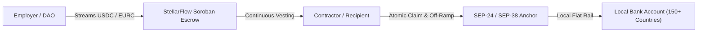

# 🌐 StellarFlow SEP Anchor Integration Blueprint (SEP-24 & SEP-38)

This guide documents the technical architecture for bridging StellarFlow continuous payment streams directly with global fiat on-ramps and off-ramps via Stellar Ecosystem Proposals.

---

## 1. Architectural Overview



By connecting streaming escrows to Stellar Anchor rails, remote workers and global contractors can withdraw streaming wages directly into their local bank accounts or mobile money wallets without dealing with centralized cryptocurrency exchanges.

---

## 2. Integrated Stellar Standards

### 2.1 SEP-0024: Interactive Deposit and Withdrawal
- **Role:** Facilitates compliance (KYC/AML) and interactive browser-based cash-out flows with licensed local anchors.
- **Workflow:**
  1. Recipient initiates withdrawal from the StellarFlow `/claims` portal.
  2. Protocol queries the anchor's `stellar.toml` for `TRANSFER_SERVER_SEP0024`.
  3. Client authenticates via SEP-10 challenge-response transaction.
  4. Anchor opens an interactive modal collecting recipient banking information.
  5. Contract claims vested tokens and transfers directly to anchor's deposit memo.

### 2.2 SEP-0038: Anchor RFQ (Request for Quote)
- **Role:** Real-time foreign exchange pricing between streaming assets (USDC, EURC) and local domestic currencies (BRL, ARS, NGN, KES).
- **Workflow:**
  1. Recipient views live estimated local fiat payout prior to triggering claim.
  2. Client queries `/prices` or `/quote` endpoint from participating anchors.
  3. Firm quote is locked for the duration of the Soroban withdrawal transaction.

---

## 3. Sandbox Testing Against SDF Test Anchor

Developers can test anchor flows on Stellar Testnet using the official SDF Anchor Sandbox:
- **Sandbox URL:** `https://testanchor.stellar.org`
- **Network Passphrase:** `Test SDF Network ; September 2015`
- **Supported Sandbox Assets:** `USDC`, `SRT`

```bash
# Query test anchor discovery info
curl -s https://testanchor.stellar.org/.well-known/stellar.toml | grep -i transfer_server
```
